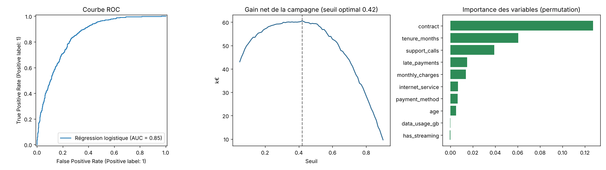

# 📉 Customer Churn Prediction — du modèle ML à la décision métier

Prédire quels abonnés d'un opérateur télécom vont résilier, puis **choisir qui cibler** avec une offre de
rétention pour maximiser le gain net — pas seulement l'AUC. Livré avec une application Streamlit.



## 🎯 Démarche

1. **Données** : 10 000 clients, 10 variables (contrat, ancienneté, facture, appels au support, retards de
   paiement…), 30 % de churn, valeurs manquantes réalistes.
2. **Pipeline scikit-learn** : imputation, standardisation, one-hot encoding dans un `ColumnTransformer`
   → aucune fuite de données entre train et test.
3. **Comparaison de 3 modèles** en validation croisée stratifiée 5 plis, puis **tuning** du Gradient Boosting
   (`RandomizedSearchCV`, 20 combinaisons).
4. **Sélection honnête** : le boosting tuné ne bat pas la régression logistique → on garde le modèle le plus
   simple et le plus explicable.
5. **Seuil métier** : au lieu du seuil de 0,5, on choisit le seuil qui maximise le gain de la campagne
   (valeur client 540 €/an, offre 40 €, 35 % de succès).
6. **Explicabilité** : importance des variables par permutation.

## 📊 Résultats (jeu de test, 2 000 clients)

| Modèle (CV 5 plis) | ROC-AUC |
|---|---|
| **Régression logistique** ✅ | **0,847** |
| Gradient Boosting tuné | 0,844 |
| Random Forest | 0,833 |
| Gradient Boosting (défaut) | 0,829 |

- ROC-AUC test **0,85**, PR-AUC 0,68 ; rappel de **89 %** sur les churners au seuil optimal de 0,42.
- Gain net estimé de la campagne : **≈ 60 k€**, contre 33 k€ si l'on ciblait tous les clients (**+81 %**).
- Facteurs principaux : type de contrat, ancienneté, appels au support, retards de paiement.

**Recommandations** : proposer en priorité un engagement 1 an aux clients mensuels de moins d'un an
d'ancienneté ayant contacté le support plusieurs fois.

## 🚀 Lancer le projet

```bash
pip install -r requirements.txt
python src/train.py                                   # entraîne, évalue, sauvegarde models/churn_model.joblib
python src/predict.py data/customers.csv -o reports/scores.csv
streamlit run app/streamlit_app.py                    # application de scoring
pytest
```

## 🛠️ Stack

Python · Pandas · scikit-learn · Matplotlib · Streamlit · Joblib · Pytest

## 📁 Structure

```
├── src/data.py            # génération / chargement des données
├── src/train.py           # comparaison, tuning, seuil métier, explicabilité
├── src/predict.py         # scoring batch
├── app/streamlit_app.py   # application web
├── models/                # modèle entraîné
└── reports/               # métriques et graphiques
```

---
👤 **Espérance DAYE** — Data Analyst / Data Scientist · [LinkedIn](https://linkedin.com/in/Esperance-DAYE)
